<div align="center">

# 🤖 Career Switch Prediction System

**An End-to-End Machine Learning Project for Predicting Career Switch Intentions**

A comparative machine learning study that analyzes candidate profiles to predict whether data professionals intend to change careers, with an emphasis on class imbalance, model evaluation, and cross-validation.

[](https://www.python.org/)
[](https://scikit-learn.org/)
[](https://pandas.pydata.org/)
[](https://jupyter.org/)
[](#)
[](#)

[Overview](#-overview) •
[Dataset](#-dataset) •
[Methodology](#-methodology) •
[Models](#-models) •
[Results](#-results) •
[Installation](#-installation-and-usage) •
[Author](#-author)

---

📓 **[Project Notebook](CSE422_Project.ipynb)** |
📄 **[Lab Report](CSE422%20Lab%20report.docx)**

</div>

## 📌 Overview

Employee retention is an important challenge for organizations seeking to maintain a skilled and productive workforce. Understanding the factors associated with career-switching intentions can help organizations investigate workforce trends and develop more informed retention strategies.

This project implements an end-to-end machine learning workflow to predict whether a candidate intends to change careers using a dataset containing **5,000 candidate observations**. It includes exploratory data analysis, data preprocessing, feature selection, class-imbalance handling, comparative model evaluation, and stratified cross-validation.

### ✨ Key Features

- **Exploratory Data Analysis:** Investigates feature distributions, missing values, class imbalance, and relationships between variables.
- **Data Preprocessing:** Applies numerical and categorical imputation, feature encoding, and feature scaling.
- **Imbalance-Aware Learning:** Uses class weighting to improve the detection of candidates likely to switch careers.
- **Comparative Modeling:** Evaluates Logistic Regression, K-Nearest Neighbors (KNN), and a Multilayer Perceptron (MLP).
- **Unsupervised Analysis:** Uses K-Means clustering and the elbow method to explore candidate groupings.
- **Model Evaluation:** Compares accuracy, precision, recall, F1-score, and ROC-AUC.
- **Cross-Validation:** Uses stratified five-fold validation to investigate model performance across different data splits.

## 📊 Dataset

| Attribute | Description |
|---|---|
| Dataset file | `Career_Switch_Prediction_Dataset.csv` |
| Total observations | 5,000 |
| Input features | 11 after feature pruning |
| Target variable | `will_change_career` |
| Target type | Binary classification |
| Majority class | Stay: 3,738 (74.76%) |
| Minority class | Switch: 1,262 (25.24%) |

### Target Variable

- `0` — Candidate is not expected to switch careers.
- `1` — Candidate is expected to switch careers.

### Missing Values

The dataset contains missing values in several categorical features:

| Feature | Missing Values |
|---|---:|
| `company_type` | 1,621 |
| `company_size` | 1,571 |
| `gender` | 1,113 |
| `major_discipline` | 724 |

These missing values are addressed during preprocessing using appropriate imputation strategies.

### 🔍 Exploratory Findings

- **City Development Index (CDI):** The analysis identifies an inverse association between CDI and the target variable in the dataset.
- **Training Hours:** The feature exhibits a right-skewed distribution, motivating the use of median-based imputation for missing numerical values.
- **Feature Selection:** `enrollee_id` and `city` are removed to reduce the influence of identifiers and high-cardinality categorical information.

*These findings describe patterns in the dataset and should not be interpreted as evidence of causation.*

## 🔬 Methodology

The project follows a structured machine learning workflow, from exploratory analysis to comparative evaluation.

```mermaid
flowchart LR
    A["Raw Data"] --> B["EDA & Feature Selection"]
    B --> C["Imputation: Median & Mode"]
    C --> D["Encoding: Ordinal & One-Hot"]
    D --> E["StandardScaler Normalization"]
    E --> F["Stratified 80/20 Train-Test Split"]
    F --> G["Model Training & Imbalance Balancing"]
    G --> H["Stratified 5-Fold Cross-Validation"]
    H --> I["ROC-AUC & F1 Evaluation"]
```



### Preprocessing Strategy

| Stage | Technique | Purpose |
|---|---|---|
| Feature selection | Remove selected identifiers and high-cardinality features | Reduce noise and memorization |
| Numerical imputation | Median | Reduce sensitivity to extreme values |
| Categorical imputation | Mode | Fill missing categorical values |
| Encoding | Ordinal or one-hot encoding, depending on feature type | Convert categorical variables into numerical representations |
| Scaling | StandardScaler | Standardize numerical feature scales |
| Data splitting | Stratified 80/20 train-test split | Preserve target-class proportions |
| Validation | Stratified 5-fold cross-validation | Assess performance across multiple folds |
| Evaluation | Precision, recall, F1-score, ROC-AUC, and accuracy | Compare predictive performance |

**Important:** For an unbiased evaluation, preprocessing transformations should be fitted only on the training data within each cross-validation fold. A scikit-learn `Pipeline` or `ColumnTransformer` is recommended to prevent data leakage.

## 🧠 Models Benchmarked

### 1. Logistic Regression

A linear classification baseline configured with `class_weight='balanced'` and `max_iter=1000`.

**Purpose:** Establish a baseline while accounting for the unequal distribution of target classes.

### 2. K-Nearest Neighbors (KNN)

A distance-based classifier using Euclidean distance.

**Configuration:** Candidate values of \(K\) from 1 to 20 are investigated using the elbow-style analysis described in the project workflow.

**Purpose:** Evaluate whether local neighborhood patterns provide useful predictive information.

### 3. Multilayer Perceptron (MLP)

A feed-forward neural network with hidden layers of 64 and 32 neurons and ReLU activation.

**Purpose:** Investigate whether nonlinear relationships improve career-switch prediction.

### 4. K-Means Clustering

An unsupervised clustering algorithm evaluated using within-cluster sum of squares (WCSS) and the elbow method for \(K=1\) through \(10\).

**Purpose:** Explore candidate groupings without directly using the target label during clustering.

*Note: K-Means is an unsupervised method, so its output is not directly comparable to supervised classification metrics without an additional evaluation procedure.*

## 📈 Results and Performance

The following results are reported for the independent 20% stratified holdout test set.

| Model | Accuracy | Precision | Recall | F1-Score | ROC-AUC |
|---|---:|---:|---:|---:|---:|
| Logistic Regression | 0.707 | 0.443 | **0.627** | **0.519** | **0.716** |
| K-Nearest Neighbors | **0.761** | **0.551** | 0.278 | 0.369 | 0.694 |
| Neural Network (MLP) | 0.728 | 0.453 | 0.381 | 0.414 | 0.687 |

*These values are the reported project results and should be verified against the executed notebook before publication.*

### 💡 Performance Analysis

**Logistic Regression — Best overall recall-oriented candidate**

- Achieves the highest recall (62.7%), F1-score (0.519), and ROC-AUC (0.716) among the three supervised models.
- Detects a larger proportion of actual career-switch cases than the other evaluated classifiers.
- Its class-weighted configuration makes it a useful candidate for further investigation when missing potential switchers is costly.

**K-Nearest Neighbors — Highest accuracy**

- Achieves the highest accuracy (76.1%) and precision (55.1%).
- Its recall of 27.8% indicates that it misses many actual positive cases at the evaluated decision threshold.
- This illustrates why accuracy alone can be misleading for imbalanced classification problems.

**Neural Network — Nonlinear baseline**

- Achieves 72.8% accuracy and 0.687 ROC-AUC.
- Does not outperform Logistic Regression on the reported recall, F1-score, or ROC-AUC.
- Further tuning and class-imbalance experiments may help establish whether a more complex architecture is beneficial.

### 🏆 Model Selection

Based on the reported test results, **Logistic Regression is the preferred candidate when recall, F1-score, and ROC-AUC are the primary selection criteria**.

The final model choice should depend on the intended application, the relative costs of false positives and false negatives, and validation results. These metrics alone do not establish that a model is suitable for real-world HR decisions.

## ✅ Stratified 5-Fold Cross-Validation

The project reports the following accuracy ranges across five validation folds:

| Model | Reported Accuracy Range |
|---|---:|
| Logistic Regression | 0.69–0.72 |
| K-Nearest Neighbors | 0.75–0.77 |
| Neural Network (MLP) | 0.75–0.78 |

These ranges provide a preliminary view of performance consistency across folds.

For a stronger comparison, report the mean and standard deviation of each metric across folds. Ensure that scaling, imputation, feature selection, and hyperparameter tuning are performed within the appropriate training folds.

## ⚠️ Limitations and Future Improvements

The project can be extended in several directions:

- [ ] **Leakage-Safe Pipelines:** Integrate preprocessing and modeling using `Pipeline` and `ColumnTransformer`.
- [ ] **Hyperparameter Optimization:** Use grid search or randomized search with cross-validation.
- [ ] **Advanced Models:** Compare Random Forest, XGBoost, LightGBM, and CatBoost where appropriate.
- [ ] **Imbalance Handling:** Evaluate class weighting, SMOTE, and other resampling methods using training folds only.
- [ ] **Threshold Optimization:** Select classification thresholds based on validation precision-recall tradeoffs.
- [ ] **Explainability:** Investigate feature contributions using SHAP, permutation importance, or other suitable methods.
- [ ] **Fairness Assessment:** Evaluate subgroup performance, privacy risks, and potential discrimination before any HR-related application.
- [ ] **Deployment:** Develop a Streamlit interface for demonstrating predictions and model behavior.
- [ ] **Reproducibility:** Record random seeds, package versions, and complete evaluation settings.

## 📁 Repository Structure

```text
CSE422/
├── assets/
│   ├── confusion_matrices/
│   └── plots/
├── Career_Switch_Prediction_Dataset.csv
├── CSE422_Project.ipynb
├── CSE422 Lab report.docx
├── requirements.txt
└── README.md
```

The `assets/` subdirectories are illustrative; retain only directories and files that actually exist in your repository.

## 🚀 Installation and Usage

### Prerequisites

- Python 3.8 or higher
- Git
- Jupyter Notebook or Google Colab

### 1. Clone the Repository

```bash
git clone https://github.com/sajedulislam5840/CSE422.git
cd CSE422
```

### 2. Create a Virtual Environment

```bash
python -m venv venv
```

Activate the environment:

**Windows**

```bash
venv\Scripts\activate
```

**macOS/Linux**

```bash
source venv/bin/activate
```

### 3. Install Dependencies

```bash
pip install -r requirements.txt
```

### 4. Launch the Notebook

```bash
jupyter notebook CSE422_Project.ipynb
```

Alternatively, open the notebook in Google Colab, upload or connect the dataset, and execute the cells sequentially.

## 🛠️ Tech Stack

| Technology | Application |
|---|---|
| Python | Programming language |
| NumPy | Numerical computation |
| Pandas | Data manipulation and analysis |
| Scikit-learn | Preprocessing, modeling, and evaluation |
| Matplotlib | Data visualization |
| Seaborn | Statistical visualization |
| Jupyter Notebook | Interactive analysis and experimentation |
| Google Colab | Optional cloud-based execution |

## 👤 Author

**Mir Mohammad Sajedul Islam**

Data Science · Artificial Intelligence · Machine Learning

Developed as part of **CSE422 — Artificial Intelligence** at BRAC University.

## 📄 Project Resources

- [Source Code and Repository](https://github.com/sajedulislam5840/CSE422)
- [Project Notebook](CSE422_Project.ipynb)
- [Lab Report](CSE422%20Lab%20report.docx)

## ⭐ Acknowledgments

This project was developed for academic learning and experimentation in machine learning, classification, model evaluation, and data analysis.

If you find this project useful, consider giving the repository a ⭐ on GitHub.

---

<div align="center">

**Built with Python and Scikit-learn**

*Learning from data, one model at a time.*

</div>
